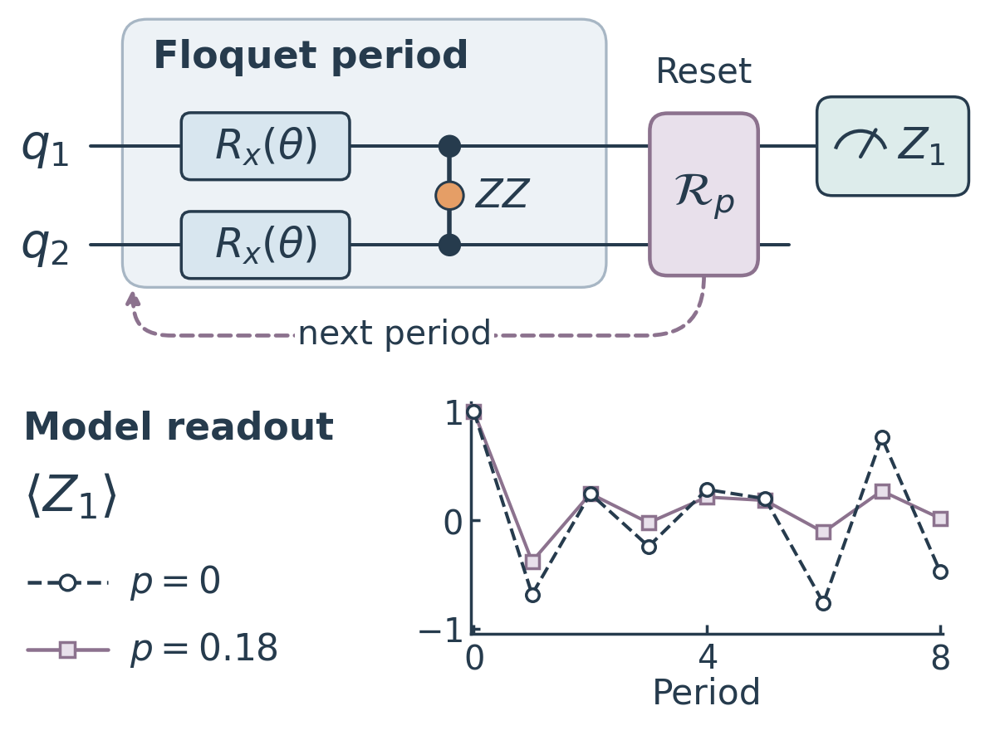

# A two-spin Floquet period and its readout



Each spin starts in the ground state. Both rotate through the same angle before an Ising interaction couples them. After each period a joint reset returns the pair to the ground state with probability $p$. The inset gives the dimensionless expectation of $Z_1$ for two reset probabilities. Open circles and dashes mark coherent evolution. Filled squares and a solid line mark evolution with reset.

The pale field groups one unitary period. A single warm point locates the interaction. The mauve return path leads into the next period, while the teal meter identifies the operator evaluated in the inset. The 85 × 63 mm original fits one column. The plot, gate labels and connections are editable in the SVG. [Vector PDF](floquet-period.pdf) · [Editable SVG](floquet-period.svg) · [Figure plan](figure-plan.json)

## Reproduce the figure

Starting from the skill directory with the plotting dependencies installed, run

```sh
python -B scripts/draw_floquet_example.py --out /path/to/new-output
```

The source evaluates an illustrative two-spin model. With angles in radians, $U_F=\exp(-i\phi Z_1Z_2/2)[R_x(\theta)\otimes R_x(\theta)]$, $\theta=0.74\pi$ and $\phi=0.36\pi$. Starting with $\rho_0=|00\rangle\langle00|$, it iterates $\rho_{n+1}=(1-p)U_F\rho_n U_F^\dagger+p\rho_0$ and plots $\mathrm{Tr}(Z_1\rho_n)$ at $n=0,\ldots,8$ for $p=0$ and $0.18$. The curves are exact model evaluations to numerical precision. [Drawing source](../../scripts/draw_floquet_example.py) · [Colors and composition](../../references/schematic-palettes.md)
